<div align="center">

# 🏭 TRIMA ERP — Trichy Integrated Manufacturing & Audit
### *From Order to Audit. Everything Connected.*

**National Institute of Technology, Tiruchirappalli — Winter Internship Evaluation**

[](https://trima-nit-trichy.vercel.app/)
[](./backend/test/benchmark.test.ts)
[](./frontend)
[](./backend)
[](./backend/prisma/schema.prisma)

</div>

---

## 🎥 Evaluation Resources

| Resource | Link |
|---|---|
| 🌐 Live Application | [TRIMA ERP – Live Demo](https://trima-nit-trichy.vercel.app/) |
| 🎬 Project Demonstration Video | [Watch the Demo on YouTube](https://youtu.be/lVT8f15_iqQ?si=NzeqaIaJGpAylkgN) |
| 📄 Design Note (2 Pages) | [View Design Note](https://drive.google.com/file/d/1lJJmbXePUc9HfJ1MUH7LH41SFC2hGeJX/view?usp=sharing) |
| 💻 Source Code | [GitHub Repository](#) |

> 🌐 **Live Evaluation Demo:** Open the live application and use the **1-Click Quick Role Login** cards (or `password123`) to test the system end-to-end.

---

## 🌟 Project Overview

**TRIMA ERP** is a full-stack, commercial-grade **Order-to-Audit Manufacturing ERP** engineered for South Indian packaged food manufacturers, benchmarked on a complete **Murukku 200g** production, inventory, GST billing, and audit lifecycle.

Every stock balance is derived from an inventory movement ledger, every financial calculation uses `Decimal.js` for precision, and every action is role-gated and audit-logged.

---

## 🔄 End-to-End Working Flow

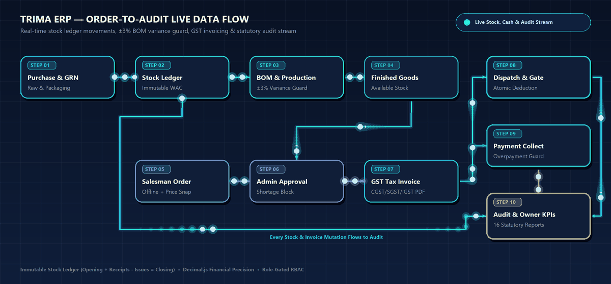

### How the Workflow Operates in Practice

1. **Procurement (`Purchases & GRN`)**: Admin/Supervisor records raw material and packaging purchases; stock and Weighted-Average Cost (WAC) update automatically.
2. **Manufacturing (`BOM & Production Runs`)**: Supervisor scales a Bill of Materials, issues raw materials, and records good output, damaged pouches, cartons, labour, and power/gas costs. Deviations beyond ±3% trigger Yield and Consumption Variance Alerts.
3. **Field Sales (`Sales & Orders`)**: Salesman books retail/wholesale orders on mobile or desktop with historical unit price snapshotting and portfolio isolation.
4. **Verification & GST Invoicing (`Admin`)**: Admin approves/rejects orders, blocks insufficient-stock orders, generates sequential FY GST invoices (2.5% CGST + 2.5% SGST for Tamil Nadu and 5% IGST for interstate), downloads PDF invoices, or issues Credit Notes on cancellation.
5. **Dispatch & Collections**: Dispatch deducts finished goods stock; payments update invoice balances and prevent overpayments.
6. **Audit & Executive Analytics**: Accountant/Auditor exports 16 real-time registers (CSV/Excel); Owner views live valuation, margins, and operational alerts.

---

## 📸 Portal & Working Flow Screenshots

<table>
<tr>
<td width="50%">

**1. Enterprise Login & 1-Click Role Auth**

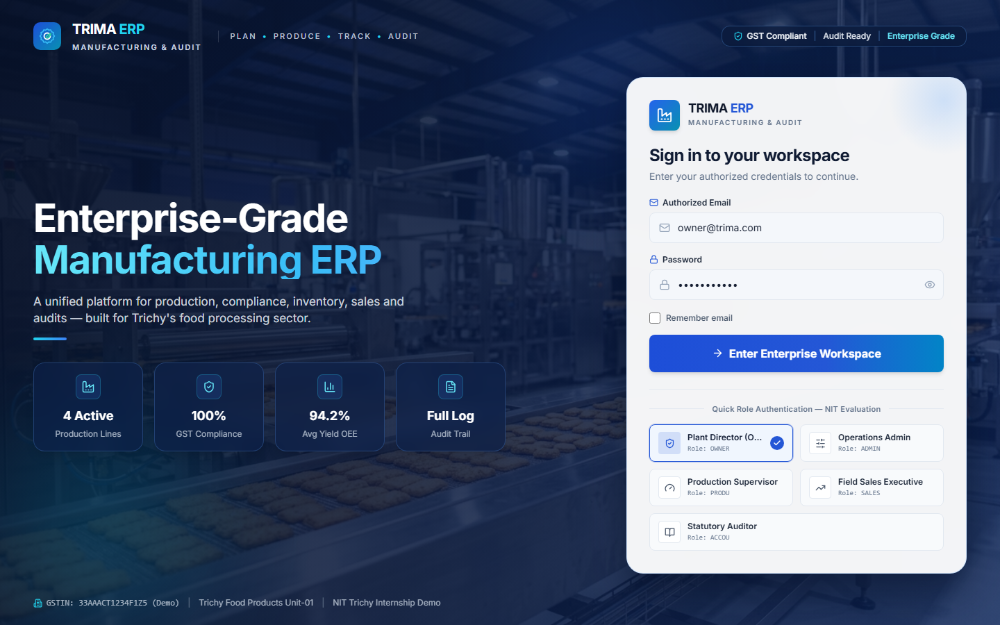

</td>
<td width="50%">

**2. Owner Executive Dashboard (KPIs & Telemetry)**

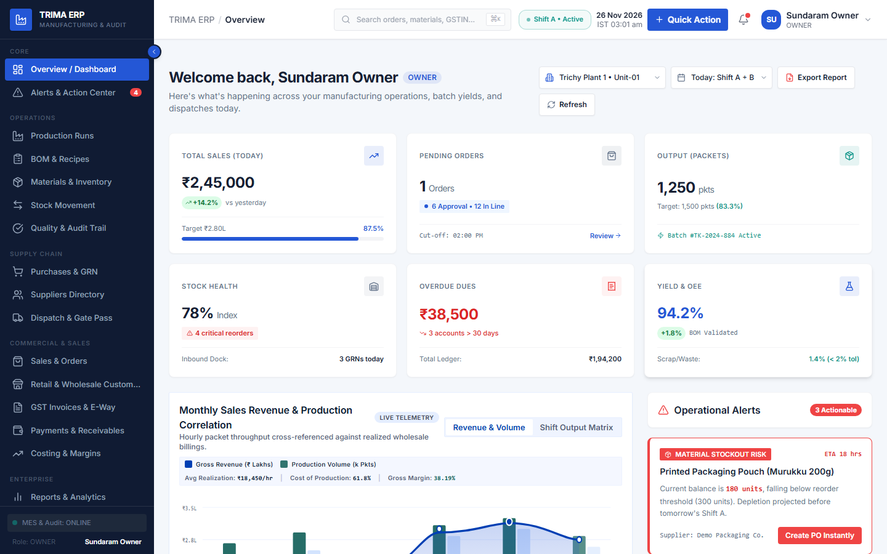

</td>
</tr>

<tr>
<td width="50%">

**3. Materials & Immutable Stock Ledger (WAC)**

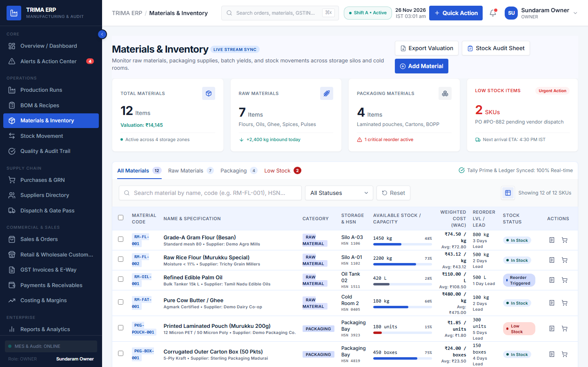

</td>
<td width="50%">

**4. Production Runs & ±3% Variance Guard**

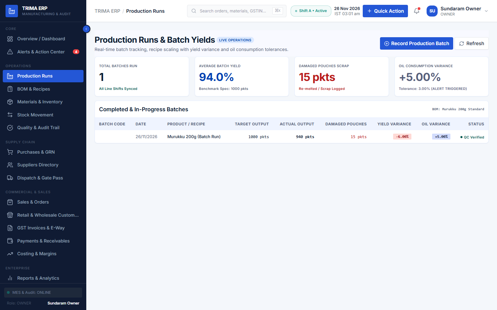

</td>
</tr>

<tr>
<td width="50%">

**5. Admin Sales Approval & GST Invoicing**

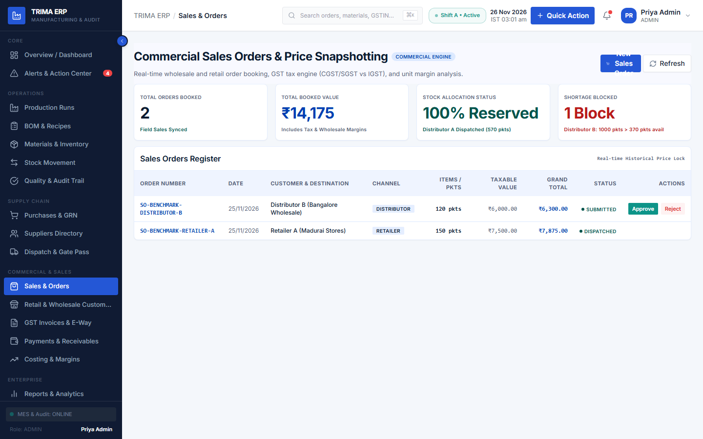

</td>
<td width="50%">

**6. Field Sales Executive Portal (Role-Isolated)**

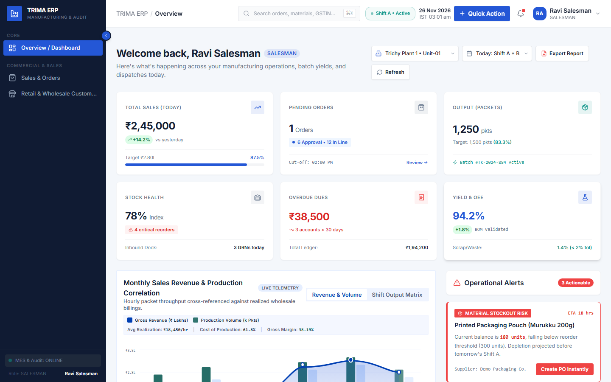

</td>
</tr>

<tr>
<td colspan="2">

**7. Statutory Auditor — 16 Real-Time Registers & CSV/Excel Exports**

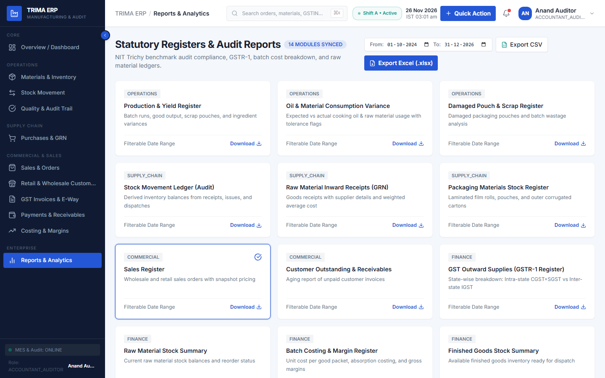

</td>
</tr>
</table>

### 📱 Mobile Responsive Experience (`390×844`)

<table>
<tr>
<td width="33%" align="center">

**Mobile Enterprise Login**

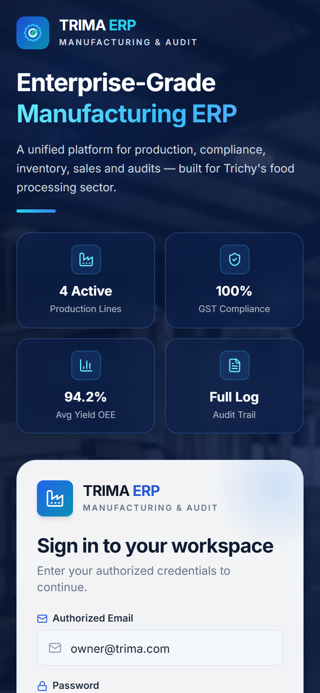

</td>
<td width="33%" align="center">

**Mobile Executive Dashboard**

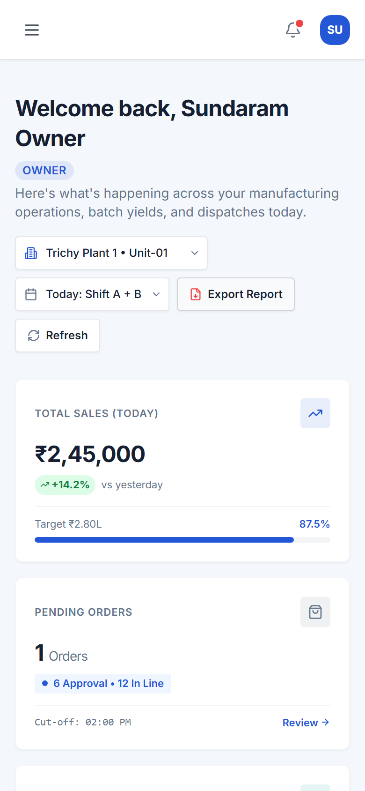

</td>
<td width="33%" align="center">

**Mobile Field Sales & Orders**

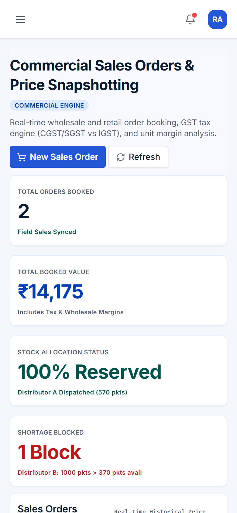

</td>
</tr>
</table>

---

## 👥 Five User Roles & Demo Credentials

> **Password for all evaluation accounts:** `password123`

| Role | Email | Capabilities & Access Control |
|---|---|---|
| **OWNER** | `owner@trima.com` | Full Executive Dashboard, live WAC stock valuation, batch costing, gross margins, all modules |
| **ADMIN** | `admin@trima.com` | Master data, order approval/rejection, GST invoicing, PDF/Credit Note, dispatch, payments |
| **PRODUCTION_SUPERVISOR** | `production@trima.com` | BOM scaling, production runs, raw/packaging issues, damaged pouch logging, variance alerts |
| **SALESMAN** | `salesman@trima.com` | Mobile-ready order booking, assigned customer portfolio, order status tracking |
| **ACCOUNTANT_AUDITOR** | `auditor@trima.com` | Read-only compliance mode across ledgers, GST summaries, costing, and all 16 audit exports |

---

## 🧪 Verified Benchmark Results (26 / 26 Passed)

Run the reproducible NIT Trichy E2E benchmark suite:

`backend/test/benchmark.test.ts`

| Benchmark Check | Expected | Verified Actual | Status |
|---|---:|---:|---|
| Flour Closing Balance (`100 + 60 − 40`) | `120 kg` | `120 kg` | ✅ PASS |
| Oil Closing Balance (`30 − 10.5`) | `19.5 L` | `19.5 L` | ✅ PASS |
| Pouch Closing Balance (`500 − 188 − 6`) | `306 pcs` | `306 pcs` | ✅ PASS |
| Finished Goods After Production (`50 + 188`) | `238 pkts` | `238 pkts` | ✅ PASS |
| Finished Goods After Dispatch (`238 − 150`) | `88 pkts` | `88 pkts` | ✅ PASS |
| Yield Variance (`188 vs 200`) | `-6%` (Flagged) | `-6.00%` (Flagged) | ✅ PASS |
| Oil Consumption Variance (`10.5 L vs 10.0 L`) | `+5%` (Flagged) | `+5.00%` (Flagged) | ✅ PASS |
| Batch Cost / Good Packet (`₹5,810 / 188`) | `₹30.90` | `₹30.90` (`38.19%` GM) | ✅ PASS |
| Retailer A GST Invoice (TN Intra-state) | `₹7,500 + ₹187.50 + ₹187.50` | `₹7,875.00` | ✅ PASS |
| Retailer A Balance After `₹4,000` Payment | `₹3,875.00` | `₹3,875.00` | ✅ PASS |
| Distributor B Order (`120 pkts` vs `88 avail`) | Blocked (`32` shortage) | Blocked (`32` shortage) | ✅ PASS |

---

## 🛠️ Technology Stack & Architecture

### Why This Stack?

I chose a responsive Web Application (React + TypeScript + Vite) paired with a Node.js/Express REST API and PostgreSQL rather than separate native mobile or low-code tools.

A single responsive web codebase lets field salesmen place orders quickly from any mobile browser while giving plant supervisors, admins, auditors, and the owner full desktop dashboards, complex BOM/costing tables, and instant PDF/CSV/Excel exports without app-store friction.

Using TypeScript end-to-end with `Decimal.js` and PostgreSQL ensures strict financial precision, atomic inventory ledger integrity, and convenient deployment on Vercel + Supabase.

| Layer | Technologies |
|---|---|
| **Frontend** | React 18, TypeScript, Vite 6, Tailwind CSS, Lucide Icons (`frontend/`) |
| **Backend** | Node.js, Express, TypeScript, Zod Validation, `Decimal.js` (`backend/`) |
| **Database** | PostgreSQL (`pg.Pool` for Supabase/Neon on Vercel; `@electric-sql/pglite` for zero-config local dev) |
| **Auth & Security** | JWT (`jsonwebtoken`), `bcryptjs`, parameterized SQL, immutable `AuditLog` |
| **Exports** | `pdfmake` (GST Tax Invoice PDF), `exceljs` (`.xlsx`), `csv-stringify` (`.csv`) |
| **Deployment** | Vercel Services (`vercel.json`) + Supabase PostgreSQL |

### Repository Structure

```text
├── vercel.json
├── backend/
│   ├── prisma/
│   │   ├── schema.prisma
│   │   └── seed.ts
│   ├── src/
│   │   ├── config/db.ts
│   │   ├── middleware/
│   │   └── modules/
│   │       ├── auth
│   │       ├── master
│   │       ├── bom
│   │       ├── purchase
│   │       ├── inventory
│   │       ├── production
│   │       ├── sales
│   │       ├── invoice
│   │        ├── dispatch
│   │        ├── payment
│   │        ├── costing
│   │        └── reports
│   └── test/
│       └── benchmark.test.ts
└── frontend/
    └── src/
        ├── layouts/
        │   └── AppShell.tsx
        └── pages/
            ├── LoginPage
            ├── ExecutiveDashboard
            ├── MaterialsInventoryMaster
            ├── SupplyChainView
            ├── OperationsView
            ├── CommercialView
            └── ReportsView
```

---

## 🚀 Quick Start (Local Development)

```powershell
# 1. Install dependencies & build
npm --prefix backend install && npm --prefix backend run build
npm --prefix frontend install && npm --prefix frontend run build

# 2. Seed local database (roles + BOM + master data)
npm --prefix backend run db:seed

# 3. Start Backend & Frontend
npm run dev:backend
npm run dev:frontend
```

### Run Automated Tests

```powershell
cd backend
npx tsx test/benchmark.test.ts
```

---

## ☁️ Deploying on Vercel + Supabase

**Hosted Demo:** [TRIMA ERP](https://trima-nit-trichy.vercel.app/)

### Evaluation Criteria Compliance

| Requirement | Implementation |
|---|---|
| **Real Database & Derived Ledger** | PostgreSQL / PGlite; stock derived from immutable `InventoryMovement` |
| **Decimal Money Math** | `Decimal.js` + PostgreSQL `DECIMAL(12,2)` / `DECIMAL(12,4)` |
| **Full Traceability** | Every stock movement links to its source document, user, and transaction date |
| **Audit Trail & Credit Notes** | `AuditLog` tracks mutations; posted invoices are cancelled through Credit Notes |
| **Reproducible Seed & Benchmark** | Seed/reset scripts and benchmark tests (`26/26` assertions) |
| **Deployability** | Vercel + Supabase or local development |

### Deployment Steps

1. Create a PostgreSQL database on **Supabase** and copy the Shared/Session Pooler URI.
2. Import this repository in **Vercel**.
3. Add environment variables:
   - `DATABASE_URL` = Supabase Pooler URI
   - `JWT_SECRET` = Strong secret string
4. Deploy. On the first request, the backend bootstraps the schema and login accounts.

---

## ✨ Implemented Stretch Goals & Future Work

- **Offline Mobile Order Capture & Sync:** Salesmen can create orders using cached catalogs when offline; orders sync when connectivity returns.
- **Admin Configuration Screens:** Dedicated User Management and Plant Settings views.
- **Future Enhancements:** Tally XML export, e-Invoice/e-Way Bill IRN JSON mock, FEFO batch-expiry tracking, and Tamil UI translation.

---

## 📋 Documented Assumptions

- **Inventory Valuation:** Weighted-Average Cost (`(Opening Value + Purchase Receipts Value) / (Opening Qty + Received Qty)`).
- **Damaged Packaging in Costing:** Damaged pouches are deducted from stock and included in batch packaging cost, divided by actual good packets rather than expected output.
- **GST Determination:** Factory is registered in Tamil Nadu (State 33). Same-state orders split 5% GST into 2.5% CGST + 2.5% SGST; inter-state orders apply 5% IGST.
- **Variance Tolerance:** Yield and material consumption deviations exceeding ±3% automatically trigger variance warnings.
- **Unit Standard:** `1 Carton = 20 Packets`, with KG↔G and L↔ML conversions.
- **Synthetic Data:** Company names, GSTINs, customers, and suppliers are dummy data for evaluation.

---

## 📚 Documentation

- **[Architecture](./docs/architecture.md)** — System architecture and data model design.
- **[Demo Script](./docs/demo-script.md)** — Step-by-step evaluation walkthrough.

---

<div align="center">

### TRIMA ERP
**From Order to Audit. Everything Connected.**

Built for Manufacturing. Designed for Accountability.

</div>
