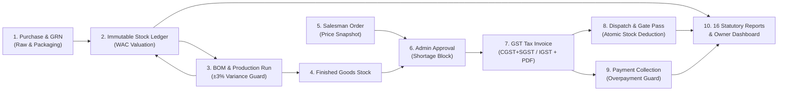

<div align="center">

# 🏭 TRIMA ERP — Trichy Integrated Manufacturing & Audit
### *From Order to Audit. Everything Connected.*

**National Institute of Technology, Tiruchirappalli — Winter Internship Evaluation**

[](./backend/test/benchmark.test.ts)
[](./frontend)
[](./backend)
[](./backend/prisma/schema.prisma)
[](./PROJECT_AUDIT_REPORT.md)

</div>

---

## 🌟 Project Overview

**TRIMA ERP** is a full-stack, commercial-grade **Order-to-Audit Manufacturing ERP** engineered for South Indian packaged food manufacturers, benchmarked on a complete **Murukku 200g** production, inventory, GST billing, and audit lifecycle.

Every stock balance is **derived from an immutable movement ledger** (`Opening + Receipts − Issues + Adjustments = Closing`), every financial calculation uses **`Decimal.js`** (zero floating-point drift), and every action is **role-gated and audit-logged**.

---

## 🔄 End-to-End Working Flow



### How the Workflow Operates in Practice
1. **Procurement (`Purchases & GRN`)**: Admin/Supervisor records raw material & packaging purchases; stock and **Weighted-Average Cost (WAC)** update automatically.
2. **Manufacturing (`BOM & Production Runs`)**: Supervisor scales a Bill of Materials, issues raw materials, and records good output, damaged pouches, cartons, labour, and power/gas costs. Deviations **> ±3%** automatically trigger **Yield** and **Consumption Variance Alerts**.
3. **Field Sales (`Sales & Orders`)**: Salesman books retail/wholesale orders on mobile or desktop with **historical unit price snapshotting** and portfolio isolation.
4. **Verification & GST Invoicing (`Admin`)**: Admin approves/rejects orders (with automatic **insufficient-stock blocking**), generates sequential FY GST invoices (**2.5% CGST + 2.5% SGST** for Tamil Nadu `33`, **5.0% IGST** for inter-state), downloads **PDF invoices**, or issues **Credit Notes** on cancellation.
5. **Dispatch & Collections**: Dispatch atomically deducts finished goods (blocking duplicate dispatches); payments update invoice `balanceDue` (blocking overpayments).
6. **Audit & Executive Analytics**: Accountant/Auditor exports **16 real-time registers** (CSV/Excel); Owner views live valuation, margins, and operational alerts.

---

## 👥 Five User Roles & Demo Credentials

> **Password for all 5 evaluation accounts:** `password123`

| Role | Email | Capabilities & Access Control |
|---|---|---|
| **OWNER** | `owner@trima.com` | Full Executive Dashboard, live WAC stock valuation, batch costing, gross margins, all modules |
| **ADMIN** | `admin@trima.com` | Master data, order approval/rejection, GST invoicing, PDF/Credit Note, dispatch, payments |
| **PRODUCTION_SUPERVISOR** | `production@trima.com` | BOM scaling, production runs, raw/packaging issues, damaged pouch logging, variance alerts |
| **SALESMAN** | `salesman@trima.com` | Mobile-ready order booking, assigned customer portfolio, order status tracking (`403` on admin routes) |
| **ACCOUNTANT_AUDITOR** | `auditor@trima.com` | Read-only compliance mode across ledgers, GST summaries, costing, and all 16 audit exports |

---

## 🧪 Verified Benchmark Results (26 / 26 Passed)

Run the reproducible NIT Trichy E2E benchmark suite (`backend/test/benchmark.test.ts`):

| Benchmark Check | Expected | Verified Actual | Status |
|---|---:|---:|---|
| Flour Closing Balance (`100 + 60 − 40`) | `120 kg` | `120 kg` | ✅ PASS |
| Oil Closing Balance (`30 − 10.5`) | `19.5 L` | `19.5 L` | ✅ PASS |
| Pouch Closing Balance (`500 − 188 − 6`) | `306 pcs` | `306 pcs` | ✅ PASS |
| Finished Goods After Production (`50 + 188`) | `238 pkts` | `238 pkts` | ✅ PASS |
| Finished Goods After Dispatch (`238 − 150`) | `88 pkts` | `88 pkts` | ✅ PASS |
| Yield Variance (`188 vs 200`) | `-6%` (Flagged) | `-6.00%` (Flagged) | ✅ PASS |
| Oil Consumption Variance (`10.5 L vs 10.0 L`) | `+5%` (Flagged) | `+5.00%` (Flagged) | ✅ PASS |
| Batch Cost / Good Packet (`₹5,810 / 188`) | `₹30.90` | `₹30.90` (`38.19%` GM) | ✅ PASS |
| Retailer A GST Invoice (TN Intra-state) | `₹7,500 + ₹187.50 + ₹187.50` | `₹7,875.00` | ✅ PASS |
| Retailer A Balance After `₹4,000` Payment | `₹3,875.00` | `₹3,875.00` | ✅ PASS |
| Distributor B Order (`120 pkts` vs `88 avail`) | Blocked (`32` shortage) | Blocked (`32` shortage) | ✅ PASS |

---

## 🛠️ Technology Stack & Architecture

### Why This Stack?
I choose a **responsive Web Application (React + TypeScript + Vite) paired with a Node.js/Express REST API and PostgreSQL** rather than separate native mobile or low-code tools. A single responsive web codebase lets field salesmen place orders quickly from any mobile browser while giving plant supervisors, admins, auditors, and the owner full desktop dashboards, complex BOM/costing tables, and instant PDF/CSV/Excel exports without app-store friction. Using TypeScript end-to-end with `Decimal.js` and PostgreSQL ensures strict financial precision, atomic inventory ledger integrity, and zero-effort cloud deployment on Vercel + Supabase.

| Layer | Technologies |
|---|---|
| **Frontend** | React 18, TypeScript, Vite 6, Tailwind CSS, Lucide Icons (`frontend/`) |
| **Backend** | Node.js, Express, TypeScript, Zod Validation, `Decimal.js` (`backend/`) |
| **Database** | PostgreSQL (`pg.Pool` for Supabase/Neon on Vercel; `@electric-sql/pglite` for zero-config local dev) |
| **Auth & Security** | JWT (`jsonwebtoken`), `bcryptjs`, parameterized SQL, immutable `AuditLog` |
| **Exports** | `pdfmake` (GST Tax Invoice PDF), `exceljs` (`.xlsx`), `csv-stringify` (`.csv`) |
| **Deployment** | Vercel Services (`vercel.json`) + Supabase PostgreSQL |

### Repository Structure
```text
├── vercel.json                  # Vercel Services config (frontend SPA + backend serverless API)
├── PROJECT_AUDIT_REPORT.md      # Full 10-section engineering & QA audit report (89/100)
├── backend/
│   ├── prisma/                  # Schema, UTF-8 DDL, benchmark reset & seed scripts
│   ├── src/
│   │   ├── config/db.ts         # Dual-mode DB (pg.Pool + auto-bootstrap / local PGlite)
│   │   ├── middleware/          # JWT authGuard, roleGuard, errorHandler
│   │   └── modules/             # auth, master, bom, purchase, inventory, production,
│   │                            # sales, invoice, dispatch, payment, costing, reports
│   └── test/                    # phase2–phase8 tests + benchmark.test.ts (26/26)
└── frontend/
    └── src/
        ├── layouts/AppShell.tsx # Collapsible sidebar (250px/72px), 64px topbar, RBAC nav
        └── pages/               # LoginPage, ExecutiveDashboard, MaterialsInventoryMaster,
                                 # SupplyChainView, OperationsView, CommercialView, ReportsView
```

---

## 🚀 Quick Start (Local Development)

```powershell
# 1. Install dependencies & build
npm --prefix backend install && npm --prefix backend run build
npm --prefix frontend install && npm --prefix frontend run build

# 2. Seed local PGlite database (5 roles + Murukku 200g BOM + master data)
npm --prefix backend run db:seed

# 3. Start Backend (http://localhost:5000) & Frontend (http://localhost:5173)
npm run dev:backend
npm run dev:frontend
```

### Run Automated Tests
```powershell
cd backend
npx tsx test/benchmark.test.ts   # 26/26 Master E2E Benchmark assertions
```

---

## ☁️ Deploying on Vercel + Supabase

- **Hosted Demo:** `https://nit-trichy-git-main-rjrahulyadavs-projects.vercel.app`

### Evaluation Criteria Compliance
| Requirement | Implementation |
|---|---|
| **Real Database & Derived Ledger** | PostgreSQL (`prisma/schema.prisma`) on Supabase / PGlite; stock derived from immutable `InventoryMovement` (`SUM(qtyIn) - SUM(qtyOut)`) |
| **Decimal Money Math** | `Decimal.js` + PostgreSQL `DECIMAL(12,2)` / `DECIMAL(12,4)` — zero float arithmetic |
| **Full Traceability** | Every stock movement links to `sourceDocumentType`, `sourceDocumentId`, `performedByUserId`, and `transactionDate` |
| **Audit Trail & Credit Notes** | `AuditLog` tracks all mutations; posted invoices are never deleted (`POST /api/invoice/:id/cancel` issues a `CreditNote`) |
| **Reproducible Seed & Benchmark** | `backend/prisma/seed.ts`, `reset.ts`, and `backend/test/benchmark.test.ts` (`26/26` assertions) |
| **Deployability** | One-click Vercel Services (`vercel.json`) + Supabase, or local Docker Compose / npm dev |

### Deployment Steps
1. Create a PostgreSQL database on **Supabase** and copy the **Shared/Session Pooler** URI (`*.pooler.supabase.com:5432`).
2. Import this repository in **[Vercel](https://vercel.com/new)** (root `vercel.json` configures both `frontend` and `backend` automatically).
3. Add Environment Variables in Vercel:
   - `DATABASE_URL` = your Supabase Pooler URI
   - `JWT_SECRET` = any strong secret string
4. Deploy — on the first request, `backend/src/config/db.ts` automatically bootstraps the schema and 5 login accounts.

---

### Implemented Stretch Goals & Known Gaps
- **Offline Mobile Order Capture & Sync (Implemented):** When offline, salesmen can still book orders using cached customer/product catalogs (`localStorage` queue) and auto-sync to PostgreSQL (`POST /api/sales`) as soon as connectivity returns.
- **Admin Configuration Screens:** `User Management` and `Plant Settings` sidebar items currently route to `ReportsView` rather than dedicated CRUD forms.
- **Other Stretch Goals:** Tally XML export, e-Invoice/e-Way Bill IRN JSON mock, FEFO batch-expiry tracking, and Tamil UI translation are not yet implemented.

### Documented Assumptions
- **Inventory Valuation:** Weighted-Average Cost (`(Opening Value + Purchase Receipts Value) / (Opening Qty + Received Qty)`).
- **Damaged Packaging in Costing:** Damaged pouches (`6` in benchmark) are deducted from stock and included in batch packaging cost, divided by **actual good packets** (`188`) rather than expected output (`200`).
- **GST Determination:** Factory is registered in Tamil Nadu (`State 33`). Same-state orders (`33`) split 5% GST into `2.5% CGST + 2.5% SGST`; inter-state orders (`29`, etc.) apply `5.0% IGST`.
- **Variance Tolerance:** Yield and material consumption deviations exceeding **`±3.0%`** automatically trigger variance warnings.
- **Unit Standard:** `1 Carton = 20 Packets` (with `KG↔G` and `L↔ML` conversions via `UnitConversionService`).
- **Synthetic Data:** All company names, GSTINs, customers, and suppliers are invented dummy data for evaluation only.

## 📚 Documentation

- **[PROJECT_AUDIT_REPORT.md](./PROJECT_AUDIT_REPORT.md)** — Complete implementation audit, bug fixes, benchmark verification, and security review.
- **[docs/architecture.md](./docs/architecture.md)** — System architecture and data model design.
- **[docs/demo-script.md](./docs/demo-script.md)** — Step-by-step evaluation walkthrough.
