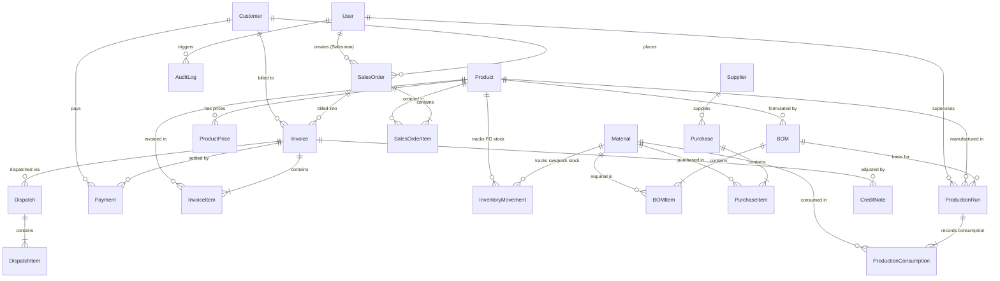

# UdyamFlow ERP — System Architecture & Design Specification

**System Name:** UdyamFlow ERP (TRIMA)  
**Enterprise Focus:** Small-scale Food & Packaged Snacks Manufacturing  
**Reference Model:** Murukku 200g Packaged Snack Operations  

---

## 1. Architectural Style & Monorepo Layout

The application is structured as a high-cohesion, decoupled monorepo:

```
order-to-audit-erp/
├── frontend/                     # React 18 + Vite + TypeScript Client
│   ├── src/
│   │   ├── components/           # shadcn/ui & domain design components
│   │   │   ├── ui/               # Base primitives (Button, Dialog, Table, etc.)
│   │   │   ├── layout/           # Header, Sidebar, MobileNav, Breadcrumbs
│   │   │   └── shared/           # DataTables, StatusBadge, ConfirmModal
│   │   ├── pages/                # Role-specific & business module pages
│   │   │   ├── auth/             # Login & session
│   │   │   ├── dashboards/       # Admin, Owner, Production, Auditor, Salesman
│   │   │   ├── master/           # Products, Customers, Suppliers, Materials
│   │   │   ├── inventory/        # Stock Ledger, Reorder Alerts, Purchases
│   │   │   ├── production/       # BOMs, Production Runs, Variance Tracking
│   │   │   ├── sales/            # Mobile Salesman Portal, Order Verification
│   │   │   ├── dispatch/         # Invoices, Dispatch, Delivery
│   │   │   ├── accounts/         # Payments, Receivables, Credit Notes
│   │   │   └── reports/          # 16 date-filtered registers & exports
│   │   ├── hooks/                # Custom React & TanStack query hooks
│   │   ├── services/             # Axios/Fetch API client wrappers
│   │   ├── contexts/             # AuthContext, NotificationContext
│   │   ├── types/                # Strict TypeScript interfaces matching backend DTOs
│   │   └── utils/                # Formatting (currency, date, unit conversions)
│   ├── tailwind.config.js        # Navy Blue (#0F172A), Teal (#0D9488) theme
│   ├── vite.config.ts
│   └── package.json
│
├── backend/                      # Node.js + Express + TypeScript Server
│   ├── src/
│   │   ├── modules/              # Domain modules (Controller + Service + Repository)
│   │   │   ├── auth/
│   │   │   ├── master/
│   │   │   ├── bom/
│   │   │   ├── purchase/
│   │   │   ├── inventory/
│   │   │   ├── production/
│   │   │   ├── sales/
│   │   │   ├── invoice/
│   │   │   ├── payment/
│   │   │   ├── costing/
│   │   │   ├── reports/
│   │   │   └── audit/
│   │   ├── middleware/           # authGuard, roleGuard, errorHandler, rateLimiter
│   │   ├── utils/                # Decimal arithmetic, unit converter, PDF/Excel generators
│   │   ├── validators/           # Zod schema validators
│   │   ├── config/               # Environment & database configuration
│   │   └── index.ts              # Express application bootstrap
│   ├── prisma/
│   │   ├── schema.prisma         # Complete PostgreSQL schema with Decimal mappings
│   │   ├── seed.ts               # Idempotent benchmark seed script
│   │   └── migrations/           # Version-controlled DB migrations
│   ├── tsconfig.json
│   └── package.json
│
├── docs/                         # Engineering documentation & evaluation assets
│   ├── architecture.md           # This document
│   ├── design-note.md            # Two-page internship design note with ER diagram
│   └── demo-script.md            # 8-minute scripted walkthrough guide
│
├── docker-compose.yml            # PostgreSQL & application container orchestration
├── .env.example                  # Environment configuration template
└── README.md                     # Setup instructions, credentials & test commands
```

---

## 2. Entity-Relationship Model (Mermaid Diagram)



---

## 3. Data Integrity & Financial Precision Guarantees

1. **Precision Rule (Decimal.js / Prisma Decimal):**
   - No native floating-point math (`0.1 + 0.2 !== 0.3`) is permitted in financial calculations or inventory units.
   - Monetary columns: `Decimal(12, 2)` (amounts up to 9,999,999,999.99 INR).
   - Quantity/Stock columns: `Decimal(12, 4)` (supporting precise fractions e.g. 1.2000 kg).
2. **Atomic Inventory Ledger:**
   - Raw and finished stock balances are never updated directly via raw manual inputs.
   - Any stock modification is an insert into `InventoryMovement`.
   - Current stock = `SUM(qtyIn) - SUM(qtyOut)`.
   - Transactions use database row locks or ACID transactions to guarantee zero concurrency race conditions (e.g. during simultaneous dispatch or order approval).
3. **Statutory GST Engine:**
   - Place of Supply verification:
     - Supplier State (`Tamil Nadu`, Code: `33`) == Customer State -> `CGST (2.5%) + SGST (2.5%)`.
     - Supplier State != Customer State -> `IGST (5.0%)`.
   - Tax rounding follows Indian GST standard rounding rules (nearest rupee/paise).
4. **Weighted-Average Valuation (WAC):**
   - On receipt of raw material:
     $$\text{New WAC Rate} = \frac{(\text{Current Qty} \times \text{Current WAC}) + (\text{Received Qty} \times \text{Purchase Rate})}{\text{Current Qty} + \text{Received Qty}}$$
   - Issued to production at the current active WAC rate, locked in at production run creation time.

