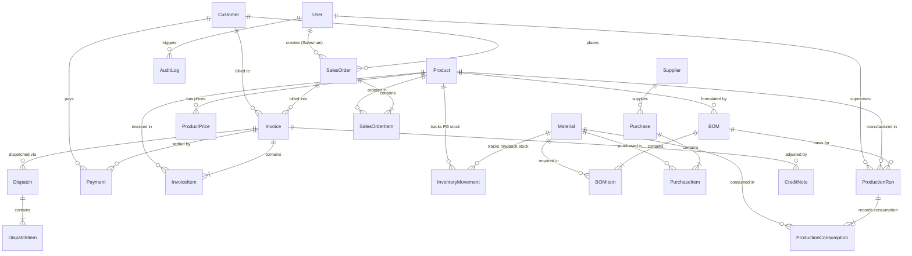

# UdyamFlow ERP — Design Note & Architectural Specification
**Institution:** National Institute of Technology, Tiruchirappalli  
**Project:** TRIMA — Trichy Integrated Manufacturing & Audit  
**Target Enterprise:** Packaged Snacks Manufacturing (Murukku 200g Reference Unit)  

---

## 1. Executive Overview & Problem Context
Small packaged food and snack enterprises in South India frequently operate with disconnected manual records, spreadsheet-based formulations, and informal verbal order confirmations. This disconnect leads to:
1. Significant material leakage, uncontrolled yield variances, and untracked packaging damage.
2. Inaccurate product costing that fails to incorporate damaged pouch scrap, direct labour, and energy overheads.
3. Errors in statutory GST computation across Intra-state (CGST + SGST) and Inter-state (IGST) dispatches.
4. Stock-outs and unfulfilled customer commitments due to absent atomic reservation.

**UdyamFlow ERP** resolves these deficiencies through an integrated *"From Order to Audit"* platform featuring role-based access control (RBAC), an immutable double-entry stock ledger, automated BOM scaling, weighted-average costing, and statutory GST compliance.

---

## 2. System Entity-Relationship (ER) Architecture

---

## 3. Mathematical Foundations & Business Rules

### A. Immutable Inventory Movement Ledger
Current available stock is never stored as an editable integer; it is derived from immutable transactional ledger rows:
$$\text{Current Stock} = \sum \text{Quantity In} - \sum \text{Quantity Out}$$
Any operation that would cause $\text{Current Stock} < 0$ without authorized adjustment is strictly rejected at the database transaction layer.

### B. Weighted-Average Costing (WAC)
Raw material issue rates are computed dynamically upon each purchase receipt:
$$\text{WAC Rate} = \frac{(\text{Current Qty} \times \text{Current WAC}) + (\text{Received Qty} \times \text{Purchase Rate})}{\text{Current Qty} + \text{Received Qty}}$$
*Benchmark Verification:* Opening flour ($100\text{ kg} \times ₹42 = ₹4,200$) plus new purchase ($60\text{ kg} \times ₹45 = ₹2,700$) yields:
$$\frac{4,200 + 2,700}{160} = \mathbf{₹43.125/\text{kg}}$$

### C. Batch Costing & Treatment of Damaged Pouches
Damaged pouches represent consumed packaging and are factored into the unit cost:
$$\text{Total Packaging Used} = \text{Good Output Packets} + \text{Damaged Pouches}$$
$$\text{Unit Cost per Good Packet} = \frac{\text{Raw Material Cost} + \text{Total Packaging Cost} + \text{Labour} + \text{Power/Gas} + \text{Overheads}}{\text{Good Output Packets}}$$
*Benchmark Verification:* Total batch cost $₹5,810$ over $188$ good packets yields $\mathbf{₹30.90}$ per packet, generating a $38.19\%$ gross margin against the $₹50.00$ selling price.

### D. Production Variance Calculations & Tolerance Alerts
$$\text{Yield Variance \%} = \left(\frac{\text{Actual Output} - \text{Expected Output}}{\text{Expected Output}}\right) \times 100 \implies \left(\frac{188 - 200}{200}\right) \times 100 = \mathbf{-6.00\%}$$
$$\text{Oil Consumption Variance \%} = \left(\frac{10.5 - 10.0}{10.0}\right) \times 100 = \mathbf{+5.00\%}$$
Whenever $|\text{Variance}| > 3.0\%$, the system automatically flags an operational warning.

### E. Statutory GST Rules
- **Intra-state (Tamil Nadu to Tamil Nadu):** $2.5\%$ CGST + $2.5\%$ SGST.  
  Retailer A ($150\text{ pkts} \times ₹50 = ₹7,500$): CGST ₹187.50 + SGST ₹187.50 $\implies$ **₹7,875.00**.
- **Inter-state (Tamil Nadu to Karnataka):** $5.0\%$ IGST.

---

## 4. Technology Stack Justification
- **PostgreSQL & Prisma:** Enforces relational foreign keys, row-level locks for concurrent dispatches, and exact `@db.Decimal(12, 2)` financial columns avoiding IEEE-754 floating-point inaccuracies.
- **Express.js & TypeScript:** Clean domain modules with role authorization middleware and Zod input validation schemas.
- **React, Vite & Tailwind CSS:** Mobile-first layout allowing field salesmen to submit orders in under 60 seconds with responsive desktop views for admin and owner analysis.

